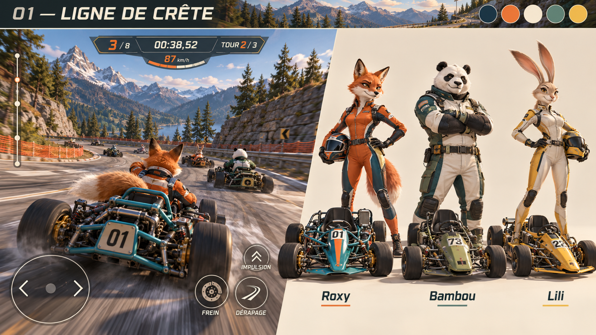
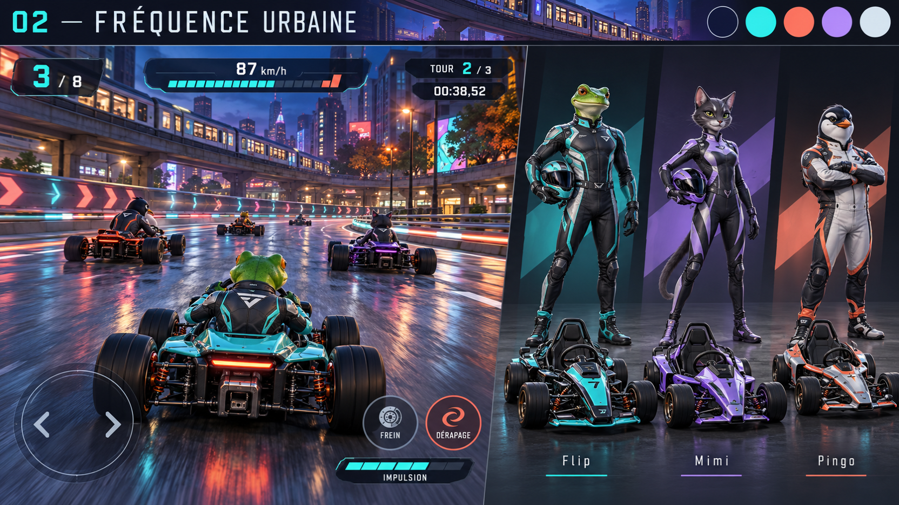
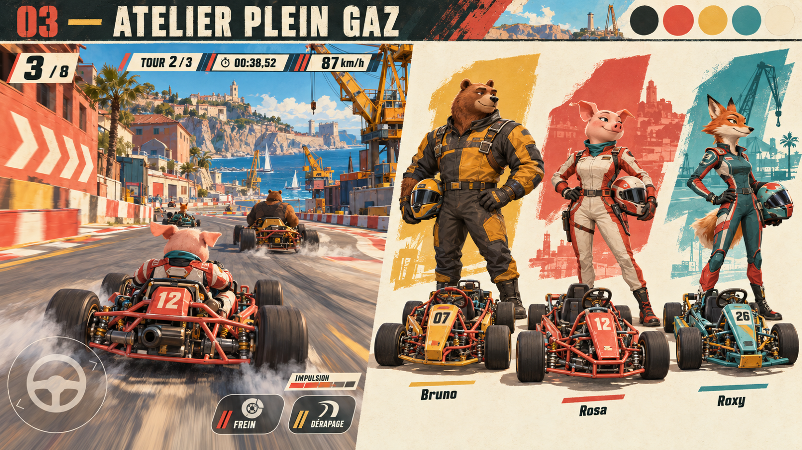

# Turbo Pattes — trois directions artistiques

Public visé : 8 à 50 ans. Les planches sont des intentions visuelles générées, pas des captures Unity ni une promesse de rendu mobile. Leur objectif commun : donner envie de maîtriser une machine et d'incarner un pilote. Chaque univers possède sa propre lumière, ses silhouettes et sa grammaire graphique.

## 1. Ligne de crête

**Intention — trois lignes**  
Un championnat de kart traverse des paysages alpins spectaculaires et des ouvrages de montagne.  
Les pilotes inspirent la compétence, le caractère et le plaisir de la compétition.  
La lumière chaude et les matériaux soignés rendent cet univers sportif accueillant à tout âge.

**Références d'ambiance :** photographie de sport automobile, reportages d'expédition, équipement de montagne, architecture des cols. Ces genres orientent les matières et la lumière ; aucun jeu ne sert de modèle.

**Palette :** pétrole `#172B36`, orange terre cuite `#E56B35`, ivoire `#E7DED0`, vert minéral `#567D78`, jaune solaire `#E6B84B`. Le pétrole structure les interfaces ; l'orange signale l'action ; l'ivoire porte les informations ; les deux autres couleurs différencient équipes et balisage.

**Police OFL :** Barlow, SemiBold pour les données, Bold pour les titres, Regular pour les menus. [Licence SIL OFL 1.1 dans le dépôt Google Fonts](https://github.com/google/fonts/blob/main/ofl/barlow/OFL.txt). La typographie des images reste indicative ; la production emploiera les vrais fichiers de police et un atlas TextMeshPro avec accents français.

**Personnages :** anatomies sportives stylisées, tête autour d'un cinquième de la hauteur, museaux distinctifs, regards concentrés, fourrure traitée en masses sculptées. Combinaisons techniques, protections, bottines et casques adaptés aux oreilles. Roxy affiche une assurance incisive ; Bambou une force tranquille ; Lili une énergie de spécialiste du freinage. Éviter la taille exagérément fine, les poses sexualisées et l'uniformisation des gabarits : tous sont d'abord des athlètes.

**Karts :** châssis tubulaires bas, moteurs et transmissions lisibles, freins, radiateurs, biellettes et pneus crédibles. Trois familles : agile pour Roxy, stable pour Bambou, empattement allongé pour Lili. La mécanique reste organisée en grandes masses ; les détails ne doivent pas brouiller la silhouette arrière.

**Décors :** cols, pins asymétriques, murs de soutènement, tunnels et installations de chronométrage. Roche gris chaud, végétation contenue, air clair et profondeur atmosphérique. Les dispositifs de sécurité et le balisage remplacent la décoration omniprésente. La vitesse vient du défilement des abords, du transfert de masse et des traces au sol.

**Interface :** instrumentation d'expédition et chronométrage sportif, traits fins ivoire, panneaux pétrole, accents orange. Bande de télémétrie haute, progression latérale discrète, centre dégagé. Les commandes tactiles restent légères et séparées du tableau de course. Aucun gros cartouche à pattes ni portrait de peluche.

**Réalisation Unity :** c'est la piste la plus exigeante en sculpture et en matières. Le code existant peut produire route, barrières, balisage, tubes et assemblages mécaniques simplifiés. Les cubes et cylindres actuels ne peuvent pas produire seuls les visages, vêtements et carrosseries montrés : créer huit pilotes en 3D avec squelette, expressions et variantes de combinaison ; créer un kit de kart avec normales et pièces partagées. Acheter éventuellement une base de rochers, de végétation et de mécanique générique, puis l'harmoniser. Fourrure sculptée et texture peinte plutôt que poils individuels ; textures de détails plutôt que visserie entièrement modélisée. Éclairage précalculé du décor, ombres dynamiques limitées aux éléments proches, niveaux de détail pour véhicules et arbres.

## 2. Fréquence urbaine

**Intention — trois lignes**  
Une ligue de pilotes transforme les infrastructures d'une ville portuaire en circuits techniques.  
La précision des trajectoires rencontre l'énergie des nuits de compétition.  
Des silhouettes nettes et des accents lumineux contrôlés donnent un caractère contemporain et électrique.

**Références d'ambiance :** photographie d'architecture à l'heure bleue, signalétique de transport, vêtements techniques, design industriel et événements sportifs nocturnes. Pas de ville ou de franchise reproduite.

**Palette :** ardoise `#111827`, turquoise `#37DDD0`, corail `#EE694F`, lavande `#B1A0F4`, blanc froid `#E9F0F2`. L'ardoise accueille les informations ; le turquoise exprime la charge ; le corail signale une action ; la lavande différencie certaines équipes. Éviter de rendre toute la route émissive.

**Police OFL :** Rajdhani, SemiBold pour le HUD, Bold pour les titres, Medium pour les menus. [Licence SIL OFL 1.1 dans le dépôt Google Fonts](https://github.com/google/fonts/blob/main/ofl/rajdhani/OFL.txt). Employer des chiffres à largeur stable dans le compteur et tester la lisibilité des petits corps sur téléphone.

**Personnages :** volumes plus tendus, combinaisons ajustées et panneaux de protection, textures mates contrastant avec les visières. Flip a de longs membres et une tête amphibienne identifiable ; Mimi une silhouette souple, précise et féline ; Pingo conserve un tronc compact et des membres adaptés à son espèce. Les équipements structurent les silhouettes sans cacher les animaux. Les expressions passent par sourcils, posture et mouvement, sans multiplier les sourires enfantins.

**Karts :** propulsion électrique, carters de batterie protégés, câblage regroupé, moteurs compacts et châssis visibles. Une bande lumineuse limitée rend chaque kart identifiable de dos. Les trois variantes privilégient respectivement changement d'appui, précision et stabilité. Conserver de vraies roues et une direction compréhensible.

**Décors :** viaducs, quais, ateliers, halles et passages sous des stations. Des fenêtres chaudes équilibrent l'heure bleue ; des surfaces humides localisées accrochent la lumière. La piste garde une valeur distincte des murs et du ciel ; les lumières décoratives ne doivent pas ressembler à des informations de conduite.

**Interface :** télémétrie fine, segments rectilignes, jauge d'impulsion linéaire, blanc froid et états corail. Des traits lumineux courts indiquent les transitions. Les panneaux sont opaques sous le texte pour résister aux reflets de la scène. Les effets du monde et les informations du HUD ne partagent pas la même intensité.

**Réalisation Unity :** architecture modulaire très compatible avec une génération par code : piles, viaducs, façades et rails peuvent être assemblés procéduralement. Les pilotes, visières et coques exigent des modèles 3D à créer ; des éléments urbains génériques peuvent être achetés et retravaillés. Risque principal : coût et lisibilité de l'éclairage nocturne. Pour mobile, privilégier éclairage précalculé, émissions sans lumière dynamique associée, sondes de réflexion et reflets peints ; ne pas dépendre de réflexions temps réel sur tout l'écran. Réserver transparence et particules à de petites surfaces. Un prototype sur appareil réel devra confirmer que les concurrents restent visibles dans les zones sombres.

## 3. Atelier plein gaz

**Intention — trois lignes**  
Des équipes de pilotes construisent des machines de caractère dans des ateliers du littoral.  
La course mêle invention mécanique, soleil franc et rivalités sportives pleines de tempérament.  
Une image sculptée et peinte, proche de l'affiche imprimée, affirme une identité immédiatement reconnaissable.

**Références d'ambiance :** sérigraphie sportive, affiches d'atelier, illustration éditoriale, carrosserie artisanale et architecture industrielle méditerranéenne. Réinterprétation des procédés et des matières, sans reprendre une affiche ou une marque précise.

**Palette :** vert charbon `#24302D`, rouge vermillon `#D94D3F`, jaune ocre `#E9B949`, bleu atelier `#3C8F91`, papier crème `#F2E7CE`. Les ombres utilisent le vert charbon ; le crème sert de support ; le rouge et l'ocre hiérarchisent les actions ; le bleu apporte le contraste frais.

**Police OFL :** Saira, Bold pour les titres et positions, SemiBold pour les commandes, Regular pour les descriptions. [Licence SIL OFL 1.1 dans le dépôt de la fonderie](https://github.com/Omnibus-Type/Saira/blob/master/OFL.txt). Employer les graisses de manière cohérente, sans étroitesse excessive pour les indications mobiles.

**Personnages :** anatomies anguleuses et expressives, aplats peints, ombres franches, détails du visage économes. Bruno possède une carrure de compétiteur endurant ; Rosa est une cheffe d'atelier volontaire, au museau bien identifiable ; Roxy une pilote vive au port assuré. Combinaisons utilitaires, coutures dessinées, gants et protections. Les gabarits restent variés, sans retomber dans une collection de sphères.

**Karts :** tubes soudés, panneaux vissés, peinture légèrement usée, moteurs regroupés en blocs lisibles. Chaque équipe personnalise son habillage sur une base mécanique commune. Les assemblages doivent rester plausibles : pas de morceaux flottants ni d'accessoires sans fonction. Les surfaces peintes portent l'essentiel de la richesse, la géométrie souligne les articulations et la silhouette.

**Décors :** port, entrepôts, grues, collines sèches, mer et murs chaulés. Les grandes ombres et les plans de couleur assurent la profondeur ; les marques de pneu et les fumées graphiques donnent du rythme. Garder un sol calme devant le joueur pour que les obstacles et adversaires se détachent.

**Interface :** fiches de chronométrage d'atelier, rectangles crème, caractères sombres, repères obliques et surlignages vermillon. Une texture imprimée discrète peut vivre dans les menus ; chiffres et commandes restent nets. Les transitions évoquent un trait de peinture rapide plutôt qu'un rebond de jouet.

**Réalisation Unity :** meilleur point de départ pour le projet procédural actuel. Le code peut construire circuits, hangars, grues, châssis, protections et accessoires ; il faut enrichir les maillages avec chanfreins, sections variables et normales maîtrisées. Les aplats et textures peintes peuvent apporter beaucoup sans multiplier les objets. En revanche, huit pilotes expressifs avec vêtements crédibles demandent des modèles 3D créés et animés : des primitives seules conserveraient l'aspect de prototype rejeté. Créer un châssis commun et quelques carrosseries originales ; acheter éventuellement des accessoires d'atelier génériques. Un shader URP à éclairage simplifié et ombres en quelques valeurs est envisageable ; prévoir une version sans contour plein écran sur mobile. Les contours peuvent être peints ou réservés aux personnages proches. Fusionner le décor par matériau et partager les atlas.

## Les huit pilotes : personnalités et variations

Ces personnalités restent constantes dans les trois univers. L'équipement, les matières et les livrées suivent la direction retenue. Les caractéristiques ci-dessous sont visuelles et narratives ; elles n'imposent pas encore de statistiques de conduite.

| Pilote | Personnalité et attitude | Ligne de crête | Fréquence urbaine | Atelier plein gaz |
| --- | --- | --- | --- | --- |
| Roxy, renarde | Audacieuse, stratège, humour sec ; regard décidé et appuis vers l'avant. | Spécialiste des cols, combinaison orange, kart agile. | Meneuse d'équipe, tenue corail, châssis nerveux. | Pilote d'essai, tenue bleu atelier, panneaux démontables. |
| Bambou, panda | Méthodique, patient, fin technicien ; carrure solide et gestes économes. | Régleur de précision, combinaison ivoire et vert. | Analyste de télémétrie, protection ardoise et turquoise. | Motoriste, combinaison crème et châssis renforcé. |
| Flip, grenouille | Inventif, vif, joueur ; longs membres, pose en équilibre. | Amateur de trajectoires serrées, équipements minéraux. | Expert des changements d'appui, tenue turquoise. | Inventeur de pièces, protections ocre et bleu. |
| Lili, lapine | Compétitrice exigeante, explosive, assurance directe ; grandes oreilles orientées en arrière. | Spécialiste du freinage, combinaison ocre et ivoire. | Pilote de qualification, tenue lavande et blanc. | Sprinteuse, combinaison vermillon et panneaux allégés. |
| Bruno, ours | Loyal, tenace, protecteur ; épaules larges, posture stable, sourire rare. | Endurance, protections orange et pétrole. | Pilier de l'équipe, combinaison corail et ardoise. | Vétéran des ateliers, combinaison charbon et ocre. |
| Mimi, chatte | Observatrice, précise, indépendante ; silhouette souple et regard latéral. | Lectrice du terrain, tenue vert minéral. | Spécialiste des trajectoires propres, tenue lavande. | Ajusteuse pointilleuse, tenue crème et bleu. |
| Pingo, pingouin | Calme sous pression, humour pince-sans-rire ; centre de gravité bas, gestes mesurés. | Expert du grip, combinaison pétrole et ivoire. | Gestionnaire d'énergie, équipement argent et corail. | Préparateur d'essais, tenue bleu atelier et ocre. |
| Rosa, cochonne | Franche, ingénieuse, meneuse ; carrure athlétique, menton levé et regard attentif. | Responsable d'assistance, tenue terre cuite et ivoire. | Conceptrice des batteries, tenue corail et blanc. | Cheffe d'atelier, combinaison crème et vermillon. |

Les planches présentent neuf apparitions : Roxy figure deux fois afin de comparer son traitement. Les huit animaux sont donc représentés au moins une fois. La fourrure, la peau, les oreilles, le bec et les museaux restent propres à chaque espèce ; les corps ne doivent pas devenir huit humains portant des masques.

## Principes de production communs

Le code consulté construit déjà les véhicules dans `KartFactory.cs`, les formes dans `MeshKit.cs` et le circuit dans `TrackBuilder.cs`. La refonte peut conserver la logique d'assemblage et les pivots de roues, tout en remplaçant progressivement les éléments visibles par des maillages préparés. Ajouter simplement davantage de cylindres ne suffira pas à atteindre les planches.

Pour mobile paysage : tester le HUD dans la taille réelle de la scène de course, sans le bandeau ni la galerie de la planche. Préserver les zones sûres, des cibles tactiles généreuses et une lecture indépendante des couleurs. Afficher « Tour », « Dérapage », « Frein » et « Impulsion » avec leurs accents. Sur PC et manette, retirer les commandes tactiles et afficher les glyphes correspondant au périphérique actif ; conserver la même hiérarchie de course. Les silhouettes, noms et symboles doivent identifier les adversaires même sans distinguer leurs couleurs.

La sensation de vitesse doit d'abord venir du cadrage arrière, du mouvement des roues, de l'inclinaison du pilote, des vibrations mesurées et des repères qui défilent près du sol. Le flou de mouvement, le bloom et les tremblements restent mesurés et désactivables. La piste et les concurrents gardent la priorité sur les effets.

Premier jalon conseillé : Roxy, un kart et un virage représentatif, puis test sur un téléphone cible et sur PC. Valider silhouettes à distance, ombres, lisibilité et temps de rendu avant de décliner les sept autres pilotes. Un objectif de 60 images/s correspond à environ 16,7 ms par image ; sa faisabilité dépendra des appareils retenus et devra être mesurée. Prévoir niveaux de détail, atlas, pièces partagées et réduction des transparences dès ce jalon.

Les modèles achetés éventuels servent de matière première générique : vérifier leurs licences et retravailler proportions, matières et silhouette. Les pilotes et signes d'identité doivent être conçus pour Turbo Pattes. Aucune référence à des personnages, objets, logos, pièces de monnaie, carapaces ou compositions emblématiques d'autres jeux ne fait partie de cette proposition. Les images générées doivent être redessinées et contrôlées avant production, notamment les petits marquages et les assemblages mécaniques.

## Recommandation

**Choisir Atelier plein gaz.** Son langage d'affiche, ses formes sculptées et sa mécanique artisanale donnent à Turbo Pattes une identité forte qui peut séduire un enfant comme un adulte. Les couleurs chaleureuses conservent le plaisir immédiat du kart ; les attitudes et les équipements apportent le sérieux sportif demandé.

C'est aussi le compromis le plus crédible avec le projet actuel : les décors et une partie des machines peuvent rester procéduraux, tandis que l'investissement 3D se concentre sur les huit pilotes et un kit de kart cohérent. La réduction des reflets complexes et de la fourrure réaliste facilite une déclinaison mobile. Cette économie ne dispense ni de sculpture ni d'animation : ces deux postes sont nécessaires pour quitter l'apparence de prototype.

Ligne de crête serait le choix d'une production plus ambitieuse en modélisation et en environnement, avec un excellent attrait sportif. Fréquence urbaine offre une rupture spectaculaire, mais demande davantage de travail sur la lisibilité nocturne et les effets pour tenir sur mobile. Je retiendrais la cohérence d'Atelier plein gaz et la discipline de lisibilité de Ligne de crête, sans mélanger leurs rendus.

## Génération des planches

Outil utilisé : **image_gen intégré**, trois générations distinctes, sans recours au CLI. Images de la direction précédente utilisées uniquement pour comprendre ce qui est rejeté ; elles ne sont pas des cibles à reproduire. Les prompts de génération sont consignés ci-dessous pour permettre de poursuivre l'exploration. Les textes et palettes du présent document font autorité pour la production ; les caractères et teintes d'une image générée restent indicatifs.

### Consigne commune aux trois prompts

Planche de concept 3D stylisé pour Turbo Pattes, PNG paysage 16:9, public de 8 à 50 ans. Bandeau supérieur avec nom et cinq pastilles de palette. À gauche, scène de course en caméra derrière le kart, adversaires visibles, sensation de vitesse et HUD français original : « 3 / 8 », « TOUR 2 / 3 », « 00:38,52 », « 87 km/h », « FREIN », « DÉRAPAGE », « IMPULSION ». À droite, trois animaux pilotes debout en pied avec chacun son kart complet et son nom. Anatomies sportives, têtes proches d'un cinquième de la hauteur, regards affirmés, combinaisons, gants, bottes et casques adaptés aux espèces. Karts bas avec châssis, direction, freins, pneus et cockpit crédibles. Lumière cohérente, silhouettes lisibles. Aucun élément reconnaissable d'une franchise, aucun logo existant, aucune pièce de monnaie, carapace, patte décorative, proportion de peluche ou œil infantile. Tout montrer sans couper les pieds ni les roues.

### Prompt 1 — complément

« 01 — LIGNE DE CRÊTE ». Palette `#172B36 #E56B35 #E7DED0 #567D78 #E6B84B`. Sport alpin en lumière chaude de fin d'après-midi, matières sculptées et saturation maîtrisée. Course sur un col asphalté avec virage incliné, pins, sommets, murs de pierre et filets orange. Roxy conduit un kart tubulaire pétrole ; transfert de masse et légère fumée de pneu. Interface d'instruments d'expédition, traits ivoire et accents orange. Galerie crème : Roxy, renarde athlétique en orange et pétrole avec kart pétrole ; Bambou, panda puissant en ivoire et vert avec kart vert ; Lili, lapine élancée en crème et ocre avec kart ocre à empattement long. Casques tenus ou portés, mécanique organisée et soignée.

### Prompt 2 — complément

« 02 — FRÉQUENCE URBAINE ». Palette `#111827 #37DDD0 #EE694F #B1A0F4 #E9F0F2`. Course électrique à l'heure bleue sous un viaduc de ville portuaire, béton indigo, reflets humides mesurés, fenêtres chaudes, signalétique turquoise et corail. Caméra derrière Flip dans un kart électrique bas ; bordures en mouvement, piste nette. Interface technique linéaire et fine. Galerie ardoise : Flip, grenouille athlétique en graphite et turquoise avec kart turquoise ; Mimi, chatte agile au pelage sombre en graphite et lavande avec kart lavande ; Pingo, pingouin compact au plumage naturel en argent et corail avec kart argent et corail. Carter de batterie, mécanique exposée, visières, matières mates ; aucun univers dystopique ni arme.

### Prompt 3 — complément

« 03 — ATELIER PLEIN GAZ ». Palette `#24302D #D94D3F #E9B949 #3C8F91 #F2E7CE`. 3D graphique peinte, ombres franches, traces de pinceau discrètes et plans anguleux inspirés de la sérigraphie. Littoral industriel méditerranéen au soleil, hangars terre cuite, mer turquoise et grues ocre. Caméra derrière Rosa au volant d'un kart artisanal corail, Bruno devant, virage de port, traces et fumées graphiques. Interface de fiche de chronométrage, rectangles crème, texte sombre, accents rouges et jaunes. Galerie papier crème : Bruno, ours puissant en combinaison charbon et ocre avec kart ocre à cadre rouge ; Rosa, cochonne cheffe d'atelier en crème et rouge avec kart corail tubulaire ; Roxy, renarde vive en bleu atelier et rouge avec kart bleu et panneaux ocre. Gants, protections, casques ; sourires assurés, aucune expression infantile.
